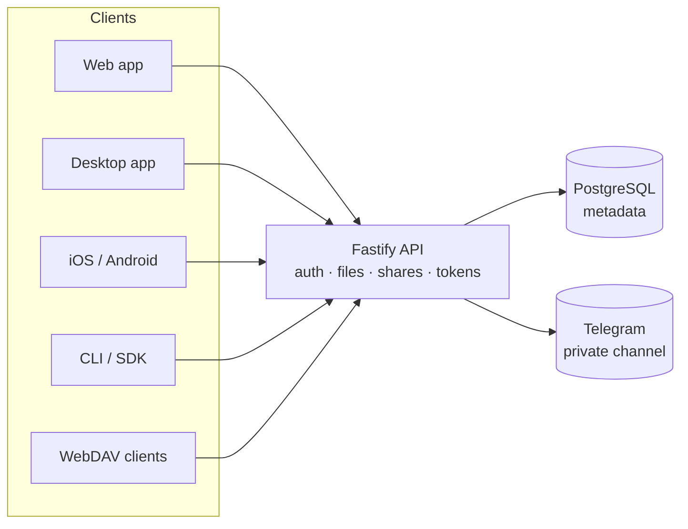

# OmniCloud

**Your files, in your own Telegram account — with a real drive on top.**

OmniCloud is an open-source, self-hosted cloud drive. File bytes live in a
private Telegram channel that belongs to you; PostgreSQL holds the logical
filesystem (folders, names, versions, trash, shares). A web app, a desktop app,
an npm SDK, a CLI and WebDAV all talk to the same server.

[](https://github.com/Hilbras/OmniCloud/actions/workflows/ci.yml)
[](https://github.com/Hilbras/OmniCloud/actions/workflows/mobile.yml)
[](https://www.npmjs.com/package/@hilbras/omnicloud)
[](./LICENSE)
[](./docs/deployment.md)

Maintained by [Hilbras](https://github.com/Hilbras) · MIT · Web · Desktop · iOS/Android shells · CLI · SDK · WebDAV

---

## Why

Cloud drives ask you to trust a vendor with the bytes and the metadata.
OmniCloud removes the storage vendor: Telegram stores the content, your server
stores only the index, and every line is MIT-licensed.

- **Files**: documents in a private Telegram channel.
- **Metadata**: PostgreSQL on your machine.
- **Keys**: optional client-side encryption; the server and Telegram then hold
  ciphertext only.
- **Access**: browser, desktop app, mobile app, CLI, SDK, WebDAV.

## Features

| Area         | What you get                                                                             |
| ------------ | ---------------------------------------------------------------------------------------- |
| Drive        | Folders, drag-to-move, search, starred, recent, trash with restore                       |
| Files        | Resumable/idempotent uploads, SHA-256 integrity checks, HTTP range downloads             |
| Versions     | Full version history with restore and pruning                                            |
| Sharing      | File links (plaintext and OCE1), folder links, password, expiry, download cap            |
| Encryption   | OCE1 end-to-end encryption; OCE2 opaque names; recovery code; device pairing             |
| Storage      | One default channel, extra channels, per-folder targets, file migration between channels |
| Offline      | Cached listings, plaintext thumbnails, explicit offline copies, upload queue             |
| Desktop      | Linux/macOS/Windows Electron app, tray uploads, background queue, auto-update scaffold   |
| Mobile       | Capacitor iOS/Android shells, bundled UI, runtime server setup, native share/download    |
| Interop      | WebDAV (rclone-tested), REST API, typed SDK, CLI, npm package, browser SDK entry         |
| Accounts     | Telegram QR/phone sign-in, local single-account mode, API token scopes, sessions         |
| Operations   | Activity log + CSV, quota alerts, folder/duplicate reports, health checks                |
| WebDAV write | PUT, MKCOL, MOVE, COPY, overwrite rules, encrypted-file refusal                          |

## Architecture



- The API serves the built web app on one port (no second process).
- Telegram is the blob store; PostgreSQL never holds file bytes.
- The desktop app starts the same server locally; the mobile shells bundle the
  UI and connect to one server you choose.
- Encryption helpers live in `packages/crypto`; the server only stores opaque
  metadata for encrypted files.

## Quick start

Requirements: Node.js ≥ 20, PostgreSQL, and a Telegram API application
(free, [my.telegram.org](https://my.telegram.org)).

```bash
git clone https://github.com/Hilbras/OmniCloud.git
cd OmniCloud
pnpm install
cp .env.example .env    # fill DATABASE_URL, TELEGRAM_API_ID/HASH, SESSION_SECRET
pnpm db:migrate
pnpm dev                # API :4000, web :5173
```

Or with Docker:

```bash
docker compose up -d
```

Production install from npm:

```bash
npm install @hilbras/omnicloud
npx omnicloud
```

Full guides: [deployment](docs/deployment.md) · [configuration](docs/deployment.md#environment-variables) · [troubleshooting](docs/troubleshooting.md).

## Desktop

```bash
pnpm --filter @hilbras/omnicloud-desktop dist
```

- Linux `.deb`/AppImage, macOS `.dmg`/`.zip`, Windows NSIS — config in
  `apps/desktop`.
- Tray uploads use a durable main-process queue (`docs/desktop-uploads.md`).
- Auto-update is wired to GitHub Releases; signing certificates are external.
- Checklist: [`docs/desktop-checklist.md`](docs/desktop-checklist.md).

## Mobile

Capacitor shells in `apps/mobile` bundle the web build and ask for the server
once; no website is loaded remotely.

```bash
pnpm --filter @hilbras/omnicloud-mobile sync
pnpm --filter @hilbras/omnicloud-mobile open:android   # Android Studio
pnpm --filter @hilbras/omnicloud-mobile open:ios       # macOS + Xcode
```

CI builds a debug APK and an unsigned iOS simulator build. Store signing needs
an Android keystore and an Apple Developer account. See
[`apps/mobile/README.md`](apps/mobile/README.md).

## Repository layout

```
apps/
  api/        Fastify server, auth, files, shares, WebDAV, routes
  web/        React app (drive, landing, download, settings) + PWA
  desktop/    Electron main/preload, tray, updater, upload queue
  mobile/     Capacitor Android/iOS projects + sync scripts
packages/
  core/       services, repositories interfaces, storage engine, providers
  crypto/     OCE1/OCE2, key derivation, name index, recovery, rotation
  database/   Prisma schema, migrations, repository implementations
  telegram/   GramJS client, MTProto provider, connection manager
  shared/     DTOs, error codes, validation, pagination
  sdk/        npm SDK, CLI, browser entry
docs/         architecture, API, deployment, security, plans, evidence
```

## Configuration (essentials)

| Variable                                      | Purpose                                        |
| --------------------------------------------- | ---------------------------------------------- |
| `DATABASE_URL`                                | PostgreSQL connection string                   |
| `TELEGRAM_API_ID` / `TELEGRAM_API_HASH`       | Telegram application credentials               |
| `SESSION_SECRET` / `OMNICLOUD_ENCRYPTION_KEY` | Session signing and sealed secrets             |
| `PORT` / `WEB_DIST_DIR`                       | API port and built web assets                  |
| `STORAGE_PROVIDER`                            | `telegram` (default) or `local`                |
| `LOCAL_STORAGE_DIR`                           | Root directory for local storage               |
| `AUTH_MODE`                                   | `telegram` (default) or `local` single account |
| `WEBDAV_ENABLED` / `WEBDAV_WRITE`             | WebDAV listener and write methods              |
| `ALLOWED_ORIGINS`                             | Split-origin deployments                       |

Defaults and every option: `docs/deployment.md`.

## Security model

- Telegram sessions are sealed at rest with `OMNICLOUD_ENCRYPTION_KEY`.
- Browser sessions are HttpOnly, SameSite=Lax; native shells exchange the cookie
  for a bearer session token because WebView cookies are unreliable.
- API tokens are stored hashed, can be read-only, expired or scoped to
  `upload`/`webdav`.
- Client-side encryption is opt-in and marked experimental; the server never
  receives keys. Plain files are readable by Telegram by design.
- The encryption design has **not** had an independent review; key rotation and
  team spaces are gated on it (`docs/audits/`, `docs/limitations.md`).

## Verification

```bash
pnpm typecheck
pnpm lint
pnpm format:check
pnpm test
```

The suite covers core services, crypto vectors, the API on in-memory repos, the
database on PostgreSQL, the web client, the SDK and the desktop queue. WebDAV
has an opt-in real-rclone test (`RCLONE_BIN=...`, evidence in
`docs/evidence/`).

## Deployment cost

- One small always-on machine is enough for a personal drive or a few hundred
  users. Free options exist (e.g. Oracle Cloud Always Free) but have capacity
  and idle-reclamation caveats.
- Managed Postgres free tiers are dev-sized; at ~10k users expect roughly
  $25/month for metadata and hosting.
- Telegram storage is free within Telegram's limits; the server still proxies
  downloads, so watch egress.
- Details and trade-offs: `docs/deployment.md`.

## Documentation

| Doc                                  | Contents                                 |
| ------------------------------------ | ---------------------------------------- |
| [Architecture](docs/architecture.md) | Components, data flow, invariants        |
| [API](docs/api.md)                   | Every endpoint, request/response, errors |
| [SDK](docs/sdk.md)                   | Node, browser entry, CLI                 |
| [Deployment](docs/deployment.md)     | Docker, systemd, TLS, WebDAV, local mode |
| [Security](docs/security.md)         | Threat model, crypto protocol, reporting |
| [Limitations](docs/limitations.md)   | Honest boundaries                        |
| [Desktop](docs/desktop-checklist.md) | Per-OS manual checks                     |
| [Mobile](apps/mobile/README.md)      | Standalone bundle, server setup, builds  |
| [Evidence](docs/evidence/)           | rclone, browser SDK, WebDAV runs         |
| [Plans](docs/next-features-plan.md)  | Shipped phases and open gates            |

## Status

- **Stable core**: drive, versions, trash, uploads, sharing, pairing, tokens,
  multi-storage, WebDAV, desktop, PWA, local storage mode.
- **Experimental**: client-side encryption, key rotation UI, team spaces,
  mobile store builds.
- **External requirements**: signing certificates (Apple/Windows), an Apple
  Developer account, a domain/TLS, and a cryptographic review for the remaining
  encryption work.

## Contributing

Read [CONTRIBUTING.md](CONTRIBUTING.md). Small, tested pull requests; keep the
gates green. Security reports: [SECURITY.md](SECURITY.md).

## License

MIT. See [LICENSE](LICENSE).
